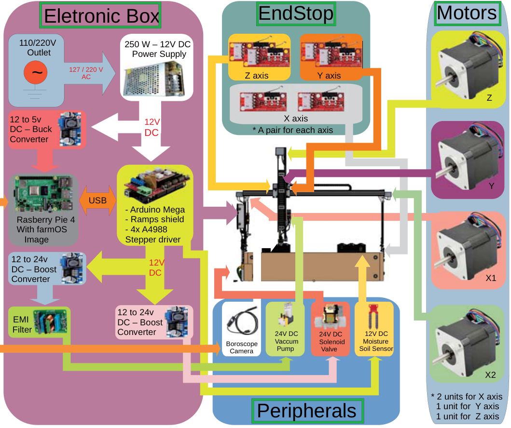
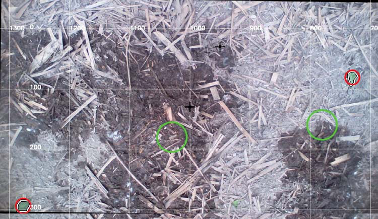
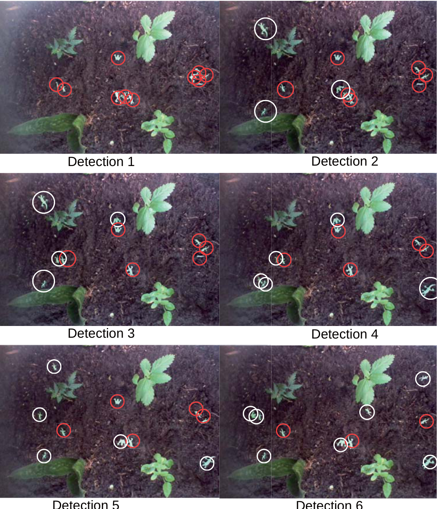

At the GPAR lab of the Federal University of Ceará, a team built a precision agriculture robot based on the open-source FarmBot project. Mounted on a raised vegetable bed, it moves on three axes and swaps tools on its own to sow, water, measure soil moisture and remove weeds, driven by a cloud-based digital twin.

I did not take part in building the robot. I worked on the experimental side, mainly on the foreign-body test: I 3D-printed the objects used in the test, worked on the computer vision in Python, photographed the bed throughout the trials and kept the electronics running.

## The system

An Arduino Mega with a RAMPS shield and A4988 drivers controls the four stepper motors and reads the end-stop switches. A Raspberry Pi 4 talks to the cloud and processes images from a borescope camera mounted at the tip of the arm. A 12 V supply powers everything, with DC-DC converters for the Raspberry Pi's 5 V and the 24 V of the vacuum pump and solenoid valve.

## What I did

- **Lighting experiment**: 15 plants in the bed, 4 registered in the system and 11 leaves standing in for weeds, with detections recorded at 10 a.m., noon and 2 p.m. over 8 consecutive days.
- **Foreign-body test**, the part I worked on most: I 3D-printed lizards and frogs, painted them green and spread them across the bed to see whether the algorithm mistook them for weeds. 40 detection runs in total.
- **Computer vision in Python**: I worked on processing the camera images for this test and helped implement the new detection logic (see results below).
- **Image collection**: I photographed the bed and the detections throughout the trials, for the analysis of the results.
- **Electronics maintenance**: I kept the control box, motors, sensors and peripherals running during the weeks of testing.

## Results

The experiments exposed the limits of the original detection algorithm:

- **Daylight**: effectiveness ranged from 62.5% to 68.2% depending on the time of day. The algorithm over-detected weeds because of shadows, sun glare and the camera's flattened image.
- **Foreign bodies**: effectiveness dropped to 40%. The algorithm could not tell a weed from any other green object.

Based on these results, we proposed a new logic that compares object positions between two camera passes: a weed grows in the same place, an insect moves. I helped implement it in Python. With it, effectiveness in the foreign-body test rose from 40% to **72.5%**.

The work was published in the *Journal of Artificial Intelligence and Systems* (vol. 7, pp. 35–60, 2025), and I am one of the co-authors. [Read the paper](https://doi.org/10.33969/AIS.2025070103).

## What I learned

- Designing an experiment so the numbers are comparable: same times of day, several days, averaged measurements.
- That a computer vision algorithm depends as much on its environment (light, shadow, camera) as on the code.
- Using 3D printing as a testing tool: fake, controlled objects to trigger the algorithm's failures.
- Keeping an electromechanical system running day to day, outside the lab bench.

*Figures: Silva et al. (2025), licensed under [CC BY 4.0](https://creativecommons.org/licenses/by/4.0/).*
