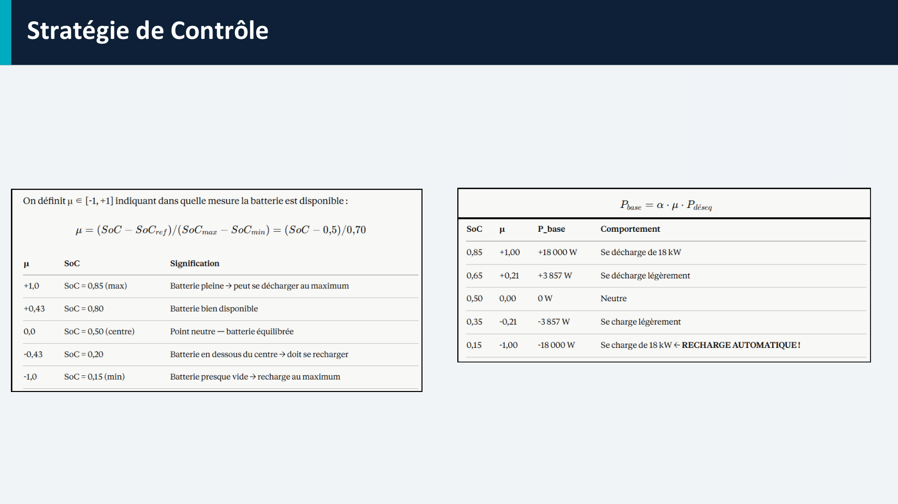
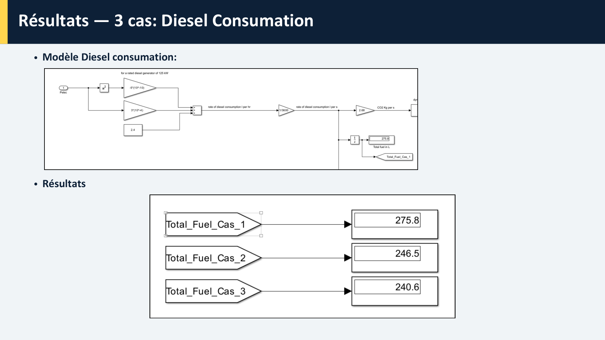
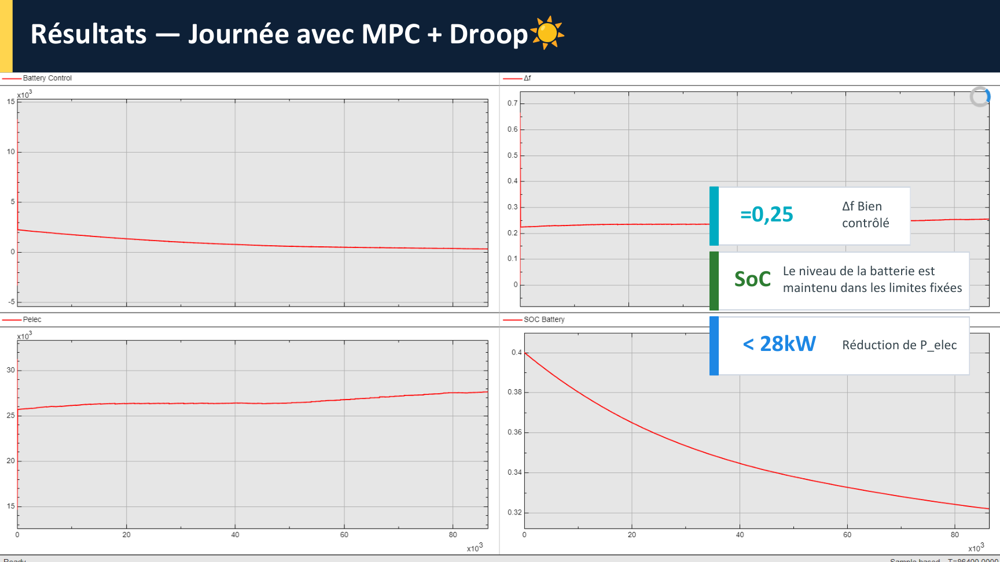

Final project of the Smart Grid elective at École Centrale de Lille, done with Ana Letícia Alves and supervised by Professor Bruno François.

In an isolated microgrid, a diesel generator sets the 50 Hz frequency but reacts slowly to load changes. The solar panel adds energy, but its output is intermittent and it does not help hold the frequency. The battery responds within milliseconds and can offset these imbalances, as long as its state of charge (SoC) is managed well. The goal was to design a model predictive controller (MPC) for the battery that would keep the frequency close to 50 Hz, respect the SoC limits and cut diesel consumption.

## The strategy

A first MPC that only minimised the frequency deviation barely acted: since the generator's droop control already corrected most of the deviation, the battery was underused and the SoC went unmanaged. So we split the battery command into two levels:

- **P_base**, slow: energy management. Depending on the SoC, the battery supports the generator when it is charged and recharges when it is low, always between 15% and 85%.
- **P_mpc**, fast: the MPC predicts how the frequency will evolve over a 20-step horizon and computes, at each instant, the power that corrects the remaining deviation, within the battery's limits.

## What I did

The diesel generator and droop control models were provided by the course. My part was the controller:

- **MPC formulation**: a model of the frequency dynamics derived from the swing equation, prediction over the horizon, and a cost function weighting the frequency deviation and the battery effort.
- **Numerical solution**: since `quadprog` is hard to use inside a MATLAB Function block, the optimisation problem is solved at each step by projected gradient descent, with the power constraints enforced by clipping.
- **Simulink implementation**: the battery block with the SoC model, the MPC and the droop, integrated into the full simulation of the three compared scenarios.

## Results

We simulated a full day, with residential load and solar production profiles, in three scenarios:

| Scenario | Diesel used over the day |
|---|---|
| 1. Diesel generator only | 275.8 L |
| 2. Generator + solar panel | 246.5 L (−10.6%) |
| 3. Generator + solar panel + battery with MPC | **240.6 L (−12.8%)** |

- **Frequency**: with droop alone, a steady-state error of about 0.32 Hz remained. With the MPC, the deviation dropped to about 0.25 Hz: a real but partial improvement.
- **Battery**: the SoC stayed within its limits throughout the day.

The professor was very pleased with the work, and the project was graded A+.

## What I learned

- That a controller that is "optimal" on paper can do nothing in practice: we had to understand why the first MPC stayed idle to arrive at the two-level structure.
- Turning a mathematical optimisation problem into a block that runs at every simulation step, with a simple and reliable solution method.
- The limits of the result: a frequency error remains, which tuning the MPC weights could reduce. And SoC management only keeps the battery from discharging too far. In simulation, it fell from 0.40 to about 0.32 over the day. Next steps would be to weight the SoC more heavily to force recharging, limit charge and discharge rates, and extend the control to several batteries (distributed MPC).
