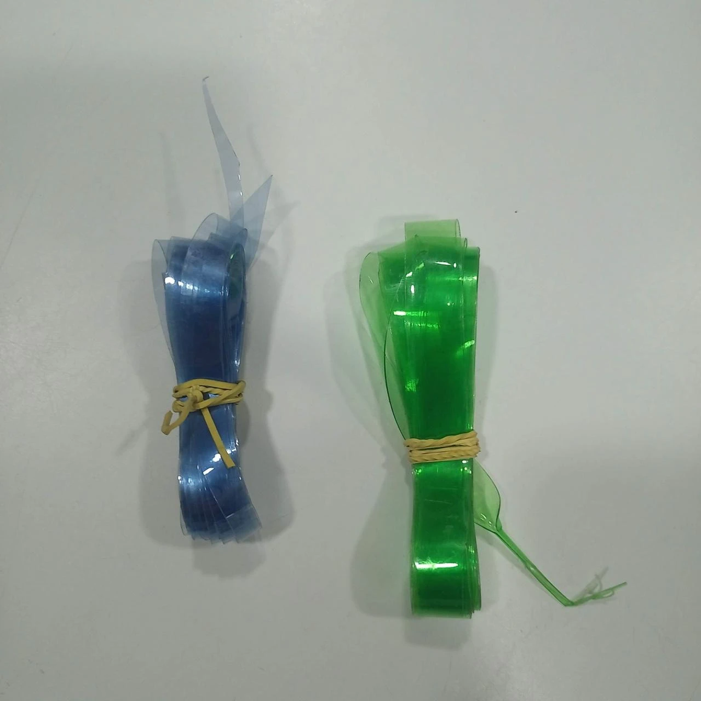
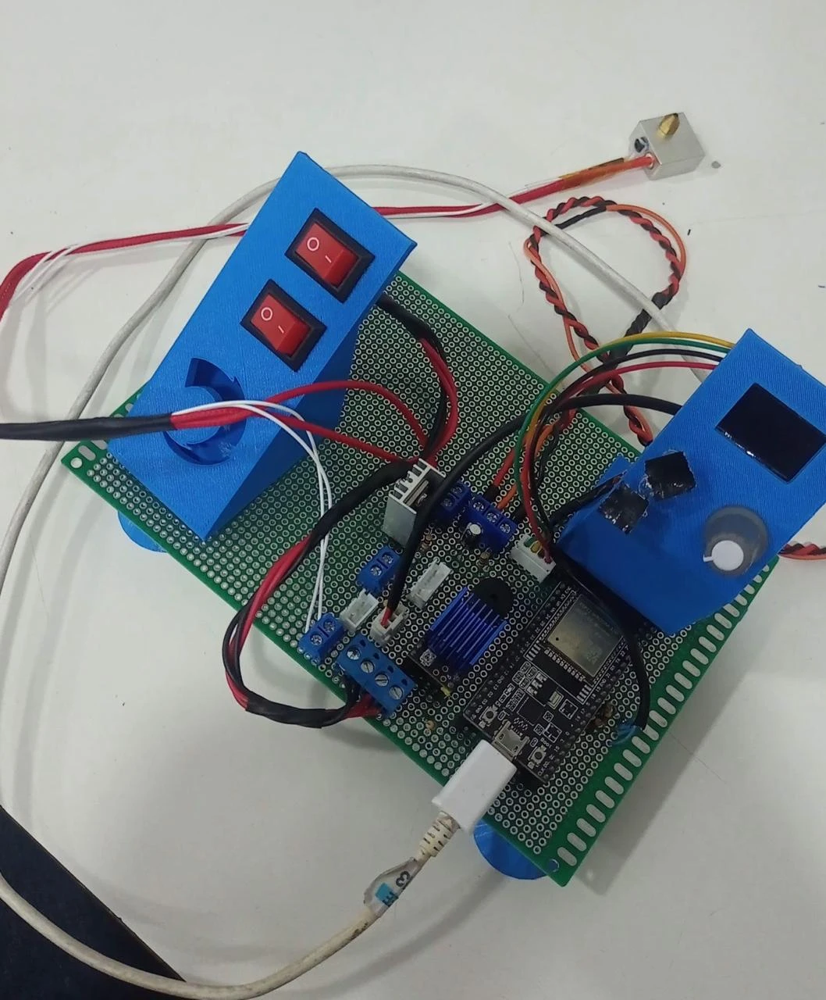
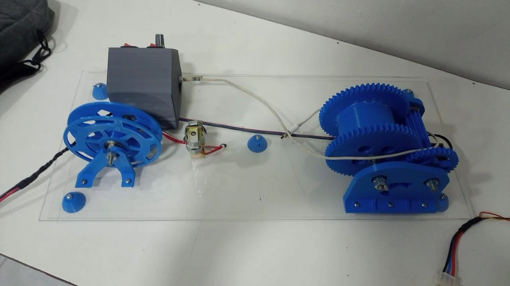
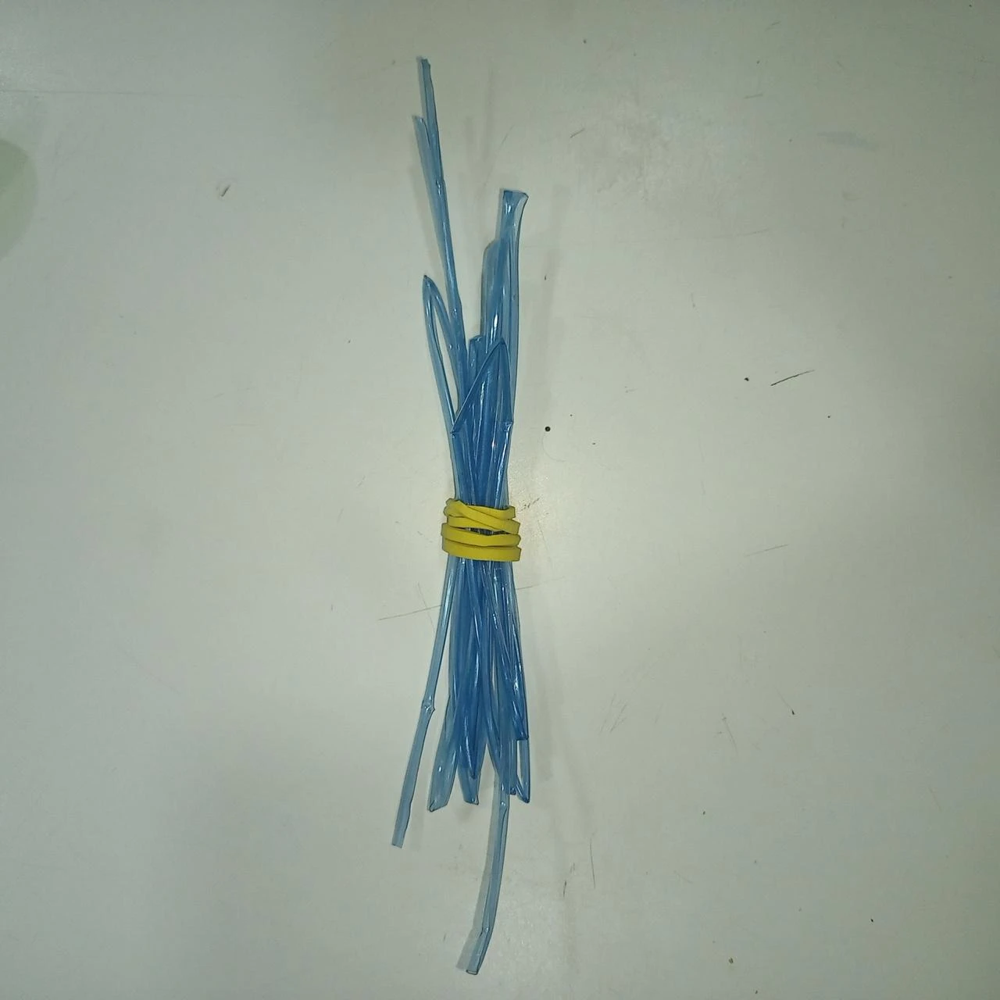

During the June 2024 holidays, as a member of PET Elétrica at the Federal University of Ceará, I built on my own a machine that recycles PET bottles and turns them into 3D printer filament.

The process has three stages. The bottle is cut into a continuous strip, wound onto a spool. The strip then goes through a heated 3D printer extruder nozzle, which melts it and shapes it to the standard 1.75 mm diameter. At the output, a stepper motor pulls the filament and winds it onto another spool, ready to use.

I was in my third semester of engineering: almost everything the project required, I learned from scratch before applying it.

## What I did

- **Nozzle temperature control**, the core of the project: thermistor sensing, heating switched by a MOSFET with PWM, and a PID controller running on the ESP32. I tuned the gains empirically, using potentiometers on the machine itself.
- **Filament pulling** with a stepper motor and its driver, with speed adjustable by potentiometer.
- **User interface** on a 128×64 OLED display: boot animation, menu, temperature, speed and error messages.
- **Safety**: a sensor detects when the strip breaks; the machine then triggers a sound and light alarm and starts shutting down. The nozzle is also protected against overheating.
- **Firmware** in C/C++, first tested in the Wokwi simulator and compiled in VS Code.
- **Electronics assembly**: circuit planned in KiCad and built on perfboard, with components and connectors hand-soldered.
- **Mechanics**: I modelled in Fusion 360 and printed (PrusaSlicer) every part of the machine, plus an enclosure for the electronics.

## Results

The machine worked end to end and produced 1.75 mm filament from PET bottles.

- **Stable temperature**: at first, the nozzle temperature swung too much. A silicone sock around the nozzle brought the variation down to about 3 °C.
- **Strip breakage**: it became a handled case, with detection and automatic shutdown, instead of a silent failure.
- **Limit reached**: the mechanical parts were printed in PLA, the only material available. With use, a gear broke, and there was no time to remake it before the end of the period.

I presented the project to a group of French professors visiting UFC, and at the UFC University Meetings (Encontros Universitários) in 2024.

## What I learned

- Closing a real control loop: the PID only became stable once I dealt with the thermal side too (the silicone sock), not just the gains.
- Taking a circuit from schematic to soldered board, by way of simulation.
- Designing for failure from the start: sensors and alarms make a machine usable by someone else.
- Choosing part materials according to the loads they carry. In a next version, I would make the gears in PETG or nylon, or buy metal parts.
