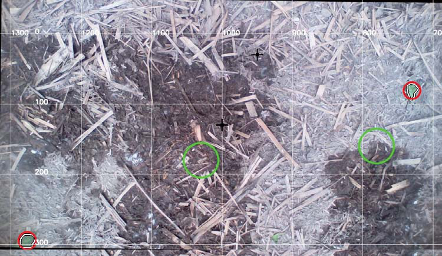
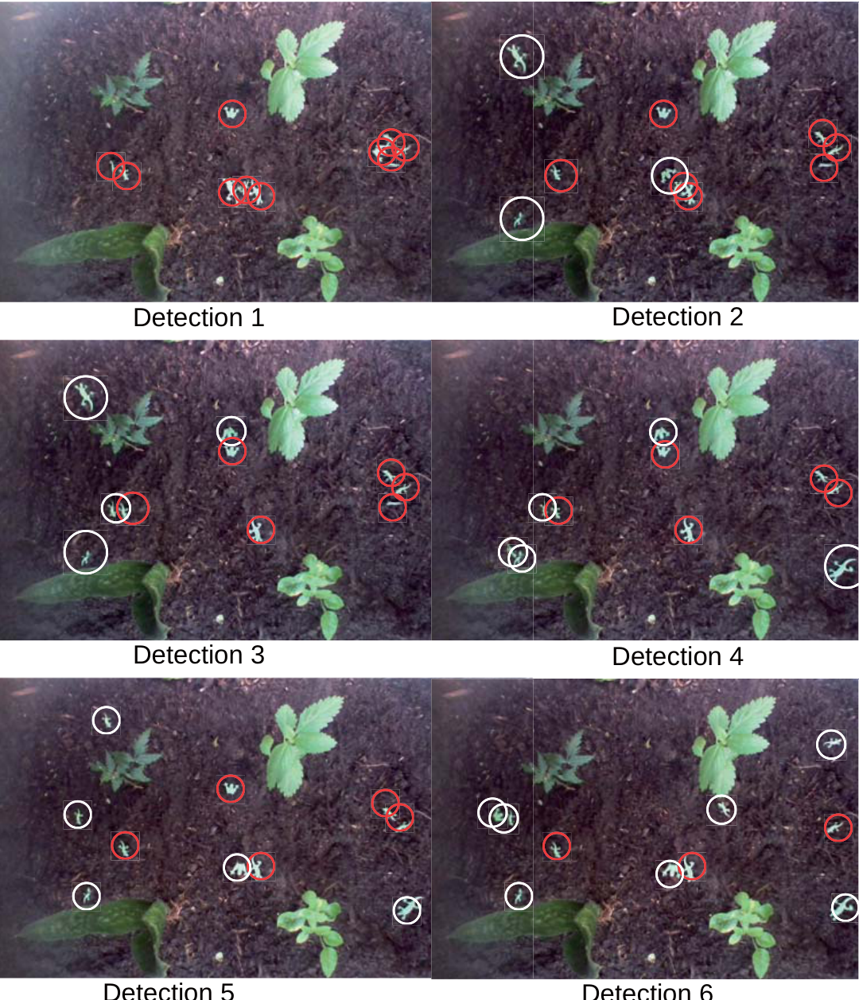

Au laboratoire GPAR de l’Université Fédérale du Ceará, une équipe a construit un robot d’agriculture de précision basé sur le projet libre FarmBot. Installé sur un bac de potager, il se déplace sur trois axes et change d’outil tout seul pour semer, arroser, mesurer l’humidité du sol et éliminer les mauvaises herbes, piloté par un jumeau numérique dans le cloud.

Je n’ai pas participé à la construction du robot. J’ai travaillé sur la partie expérimentale, surtout sur le test des corps étrangers : j’ai imprimé en 3D les objets du test, travaillé sur la vision par ordinateur en Python, photographié le bac tout au long des essais et assuré le bon fonctionnement de l’électronique.

## Le système

Une carte Arduino Mega avec un shield RAMPS et des drivers A4988 commande les quatre moteurs pas à pas et lit les capteurs de fin de course. Un Raspberry Pi 4 communique avec le cloud et traite les images d’une caméra endoscopique fixée au bout du bras. Une alimentation 12 V alimente l’ensemble, avec des convertisseurs DC-DC pour les 5 V du Raspberry Pi et les 24 V de la pompe à vide et de l’électrovanne.

## Ce que j’ai fait

- **Expérience sur la luminosité** : 15 plantes dans le bac, dont 4 enregistrées dans le système et 11 feuilles jouant le rôle de mauvaises herbes, avec des détections relevées à 10 h, à midi et à 14 h pendant 8 jours consécutifs.
- **Test des corps étrangers**, la partie sur laquelle j’ai le plus travaillé : j’ai imprimé en 3D des lézards et des grenouilles, peints en vert et répartis dans le bac, pour voir si l’algorithme les confondait avec des mauvaises herbes. Au total, 40 séries de détection.
- **Vision par ordinateur en Python** : j’ai travaillé sur le traitement des images de la caméra pour ce test et participé à l’implémentation de la nouvelle logique de détection (voir les résultats ci-dessous).
- **Collecte d’images** : j’ai photographié le bac et les détections tout au long des essais, pour l’analyse des résultats.
- **Maintenance de l’électronique** : j’ai maintenu en état de marche le boîtier de commande, les moteurs, les capteurs et les périphériques pendant les semaines d’essais.

## Résultats

Les expériences ont montré les limites de l’algorithme de détection d’origine :

- **Lumière du jour** : l’efficacité variait entre 62,5 % et 68,2 % selon l’heure. L’algorithme détectait trop de mauvaises herbes, à cause des ombres, des reflets du soleil et de l’image aplatie de la caméra.
- **Corps étrangers** : l’efficacité tombait à 40 %. L’algorithme ne savait pas distinguer une mauvaise herbe d’un objet vert quelconque.

À partir de ces résultats, nous avons proposé une nouvelle logique, qui compare la position des objets entre deux passages de la caméra : une mauvaise herbe pousse au même endroit, un insecte se déplace. J’ai participé à son implémentation en Python. Avec elle, l’efficacité lors du test des corps étrangers est passée de 40 % à **72,5 %**.

Ces travaux ont été publiés dans le *Journal of Artificial Intelligence and Systems* (vol. 7, p. 35–60, 2025), dont je suis l’un des coauteurs. [Lire l’article](https://doi.org/10.33969/AIS.2025070103).

## Ce que j’ai appris

- Concevoir une expérience pour que les chiffres soient comparables : mêmes horaires, plusieurs jours, moyenne des mesures.
- Qu’un algorithme de vision par ordinateur dépend autant de l’environnement (lumière, ombre, caméra) que du code.
- Utiliser l’impression 3D comme outil de test : des objets factices et maîtrisés pour provoquer les erreurs de l’algorithme.
- Maintenir un système électromécanique en état de marche au quotidien, hors du banc d’essai.

*Figures : Silva et al. (2025), sous licence [CC BY 4.0](https://creativecommons.org/licenses/by/4.0/deed.fr).*
