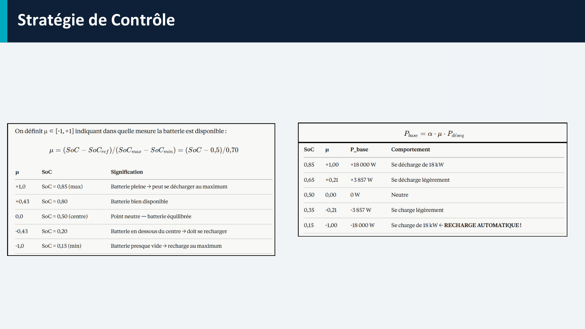
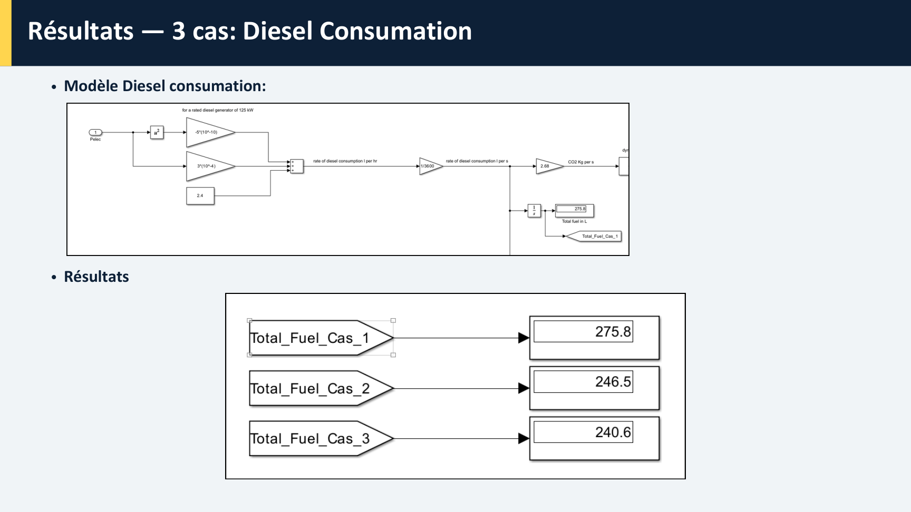
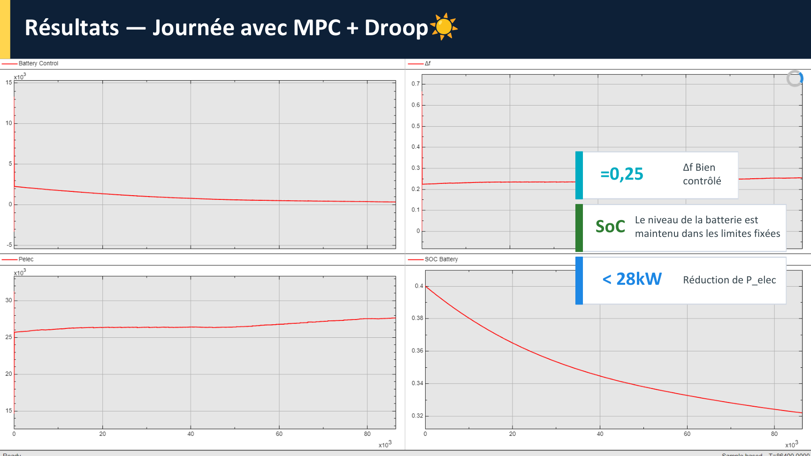

Projet final de l’électif Smart Grid de l’École Centrale de Lille, réalisé en binôme avec Ana Letícia Alves et encadré par Bruno François.

Dans un micro-réseau isolé, un groupe diesel impose la fréquence de 50 Hz, mais réagit lentement aux variations de charge. Le panneau solaire apporte de l’énergie, mais produit de façon intermittente et n’aide pas à tenir la fréquence. La batterie réagit en quelques millisecondes et peut compenser ces déséquilibres, à condition que son état de charge (SoC) soit bien géré. L’objectif était de concevoir une commande prédictive (MPC) pour la batterie qui maintienne la fréquence proche de 50 Hz, respecte les limites du SoC et réduise la consommation de diesel.

## La stratégie

Un premier MPC qui minimisait seulement l’écart de fréquence n’agissait presque pas : comme le droop du générateur corrigeait déjà une bonne partie de l’écart, la batterie restait sous-utilisée et le SoC n’était pas contrôlé. Nous avons donc séparé la consigne de la batterie en deux niveaux :

- **P_base**, lent : gestion de l’énergie. Selon le SoC, la batterie aide le générateur quand elle est chargée et se recharge quand elle est basse, toujours entre 15 % et 85 %.
- **P_mpc**, rapide : le MPC prédit l’évolution de la fréquence sur un horizon de 20 pas et calcule à chaque instant la puissance qui corrige l’écart restant, dans les limites de la batterie.

## Ce que j’ai fait

Les modèles du groupe diesel et du droop control étaient fournis par l’électif. Ma partie était la commande :

- **Formulation du MPC** : modèle de la dynamique de la fréquence à partir de l’équation d’oscillation (swing equation), prédiction sur l’horizon et fonction de coût avec des poids sur l’écart de fréquence et sur l’effort de la batterie.
- **Résolution numérique** : comme `quadprog` est difficile à utiliser dans un bloc MATLAB Function, le problème d’optimisation est résolu à chaque pas par gradient projeté, avec les contraintes de puissance appliquées par saturation.
- **Implémentation sous Simulink** : le bloc batterie avec le modèle du SoC, le MPC et le droop, intégré à la simulation complète des trois scénarios comparés.

## Résultats

Nous avons simulé une journée complète, avec des profils de consommation résidentielle et de production solaire, dans trois scénarios :

| Scénario | Diesel consommé sur la journée |
|---|---|
| 1. Groupe diesel seul | 275,8 L |
| 2. Groupe diesel + panneau solaire | 246,5 L (−10,6 %) |
| 3. Groupe diesel + panneau solaire + batterie avec MPC | **240,6 L (−12,8 %)** |

- **Fréquence** : avec le droop seul, il restait une erreur statique d’environ 0,32 Hz. Avec le MPC, l’écart est descendu à environ 0,25 Hz : une amélioration réelle, mais partielle.
- **Batterie** : le SoC est resté dans ses limites toute la journée.

Le professeur a beaucoup apprécié le travail, et le projet a été validé avec la note A+.

## Ce que j’ai appris

- Qu’une commande « optimale » sur le papier peut ne rien faire en pratique : il a fallu comprendre pourquoi le premier MPC restait inactif pour aboutir à la structure à deux niveaux.
- Passer d’une formulation mathématique d’optimisation à un bloc qui s’exécute à chaque pas de simulation, avec une méthode de résolution simple et fiable.
- Les limites du résultat : il reste une erreur de fréquence, qu’un réglage des poids du MPC pourrait réduire. Et la gestion du SoC empêche seulement la batterie de trop se décharger. En simulation, il est passé de 0,40 à environ 0,32 sur la journée. Les prochaines étapes seraient de donner plus de poids au SoC pour forcer la recharge, de limiter la vitesse de charge et de décharge et d’étendre la commande à plusieurs batteries (MPC distribué).
