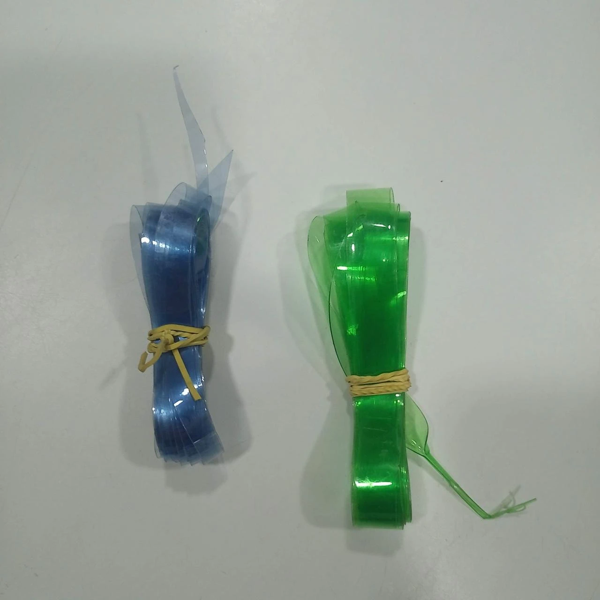
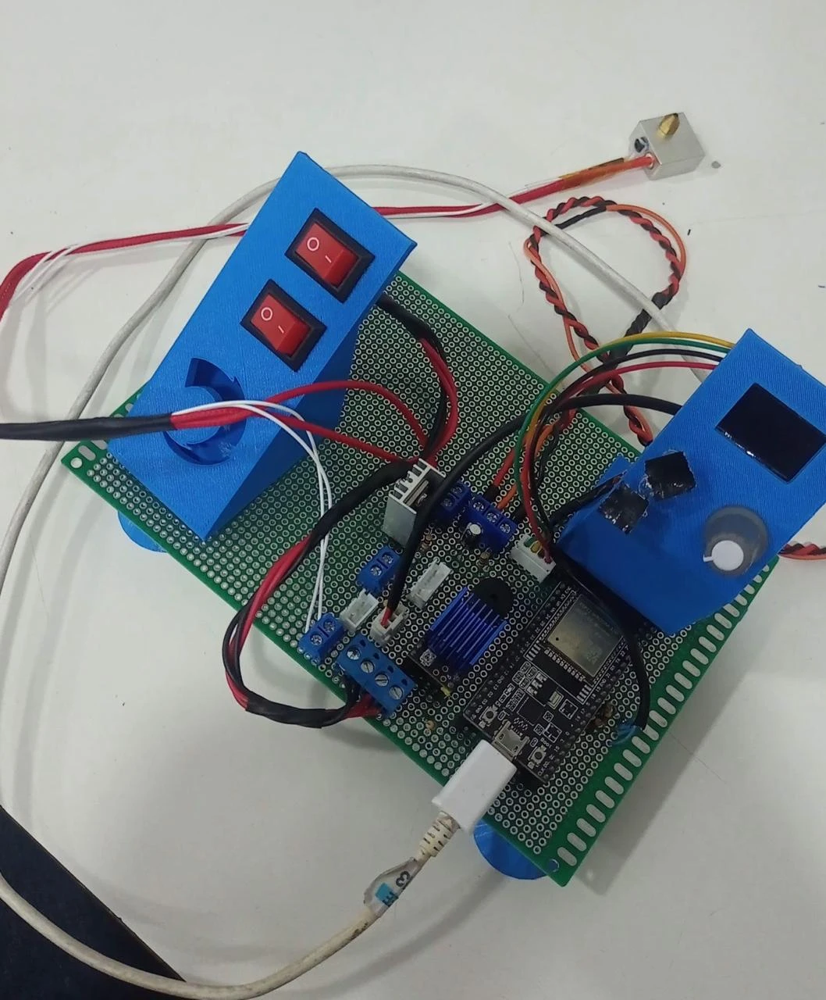
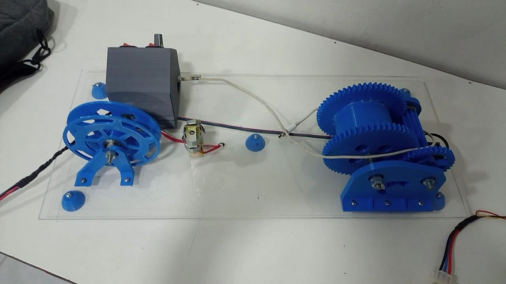
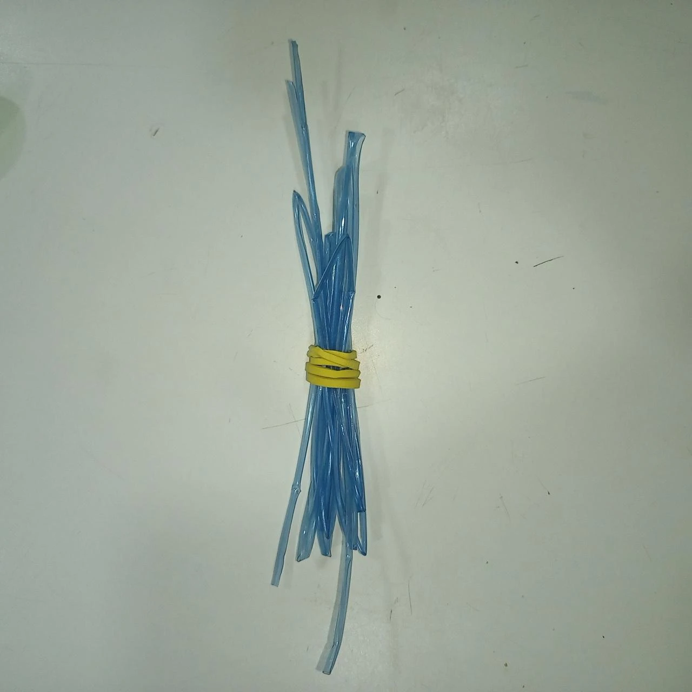

Pendant les vacances de juin 2024, en tant que membre du PET Elétrica de l’Université Fédérale du Ceará, j’ai construit seul une machine qui recycle des bouteilles PET et les transforme en filament pour imprimante 3D.

Le procédé comporte trois étapes. La bouteille est découpée en une bande continue, enroulée sur une bobine. Cette bande passe dans une buse d’extrusion d’imprimante 3D chauffée, qui la fait fondre et lui donne le diamètre standard de 1,75 mm. En sortie, le filament est tiré par un moteur pas à pas et enroulé sur une autre bobine, prêt à l’emploi.

J’étais en 3e semestre d’école d’ingénieurs : presque tout ce que le projet demandait, je l’ai appris de zéro avant de l’appliquer.

## Ce que j’ai fait

- **Régulation de température de la buse**, le cœur du projet : mesure par thermistance, chauffe commutée par un MOSFET en PWM et un régulateur PID sur l’ESP32. J’ai réglé les gains de manière empirique, à l’aide de potentiomètres sur la machine.
- **Entraînement du filament** par un moteur pas à pas et son driver, avec une vitesse réglable par potentiomètre.
- **Interface** sur un écran OLED 128×64 : animation de démarrage, menu, température, vitesse et messages d’erreur.
- **Sécurité** : un capteur détecte la rupture de la bande ; la machine déclenche alors une alerte sonore et lumineuse, puis lance l’arrêt. La buse est aussi protégée contre la surchauffe.
- **Firmware** en C/C++, testé d’abord sur le simulateur Wokwi et compilé dans VS Code.
- **Montage électronique** : circuit conçu sous KiCad et monté sur plaque à pastilles, avec les composants et connecteurs soudés à la main.
- **Mécanique** : j’ai modélisé sous Fusion 360 et imprimé (PrusaSlicer) toutes les pièces de la machine, ainsi qu’un boîtier pour l’électronique.

## Résultats

La machine a fonctionné de bout en bout et a produit du filament de 1,75 mm à partir de bouteilles PET.

- **Température stable** : au départ, la température de la buse oscillait trop. Une gaine en silicone autour de la buse a réduit la variation à environ 3 °C.
- **Rupture de la bande** : c’est devenu un cas prévu, avec détection et arrêt automatique, plutôt qu’une panne silencieuse.
- **Limite rencontrée** : les pièces mécaniques étaient imprimées en PLA, le seul matériau disponible. À l’usage, un engrenage a cassé, et je n’ai pas eu le temps de le refaire avant la fin de la période.

J’ai présenté le projet à un groupe de professeurs français en visite à l’UFC, ainsi qu’aux Rencontres universitaires de l’UFC en 2024.

## Ce que j’ai appris

- Boucler une vraie boucle de régulation : le PID n’est devenu stable qu’une fois le côté thermique traité (la gaine en silicone), pas seulement les gains.
- Mener un circuit du schéma à la carte soudée, en passant par la simulation.
- Penser aux défaillances dès le départ : capteurs et alertes rendent une machine utilisable par quelqu’un d’autre.
- Choisir le matériau des pièces selon les efforts qu’elles subissent. Dans une prochaine version, je ferais les engrenages en PETG ou en nylon, ou j’achèterais des pièces métalliques.
