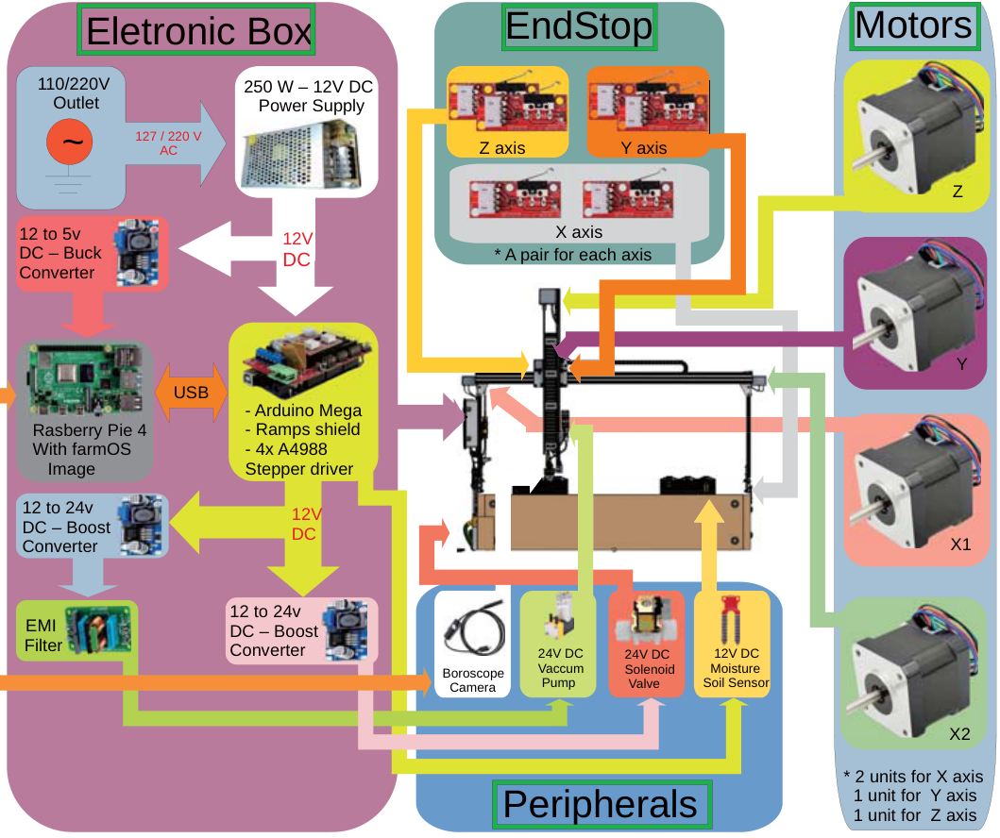
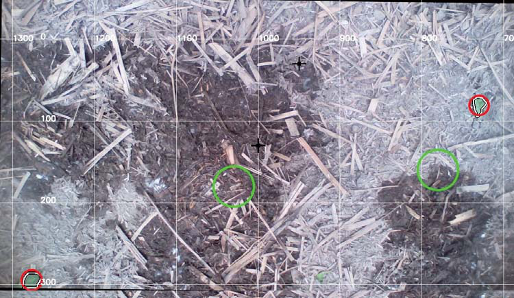
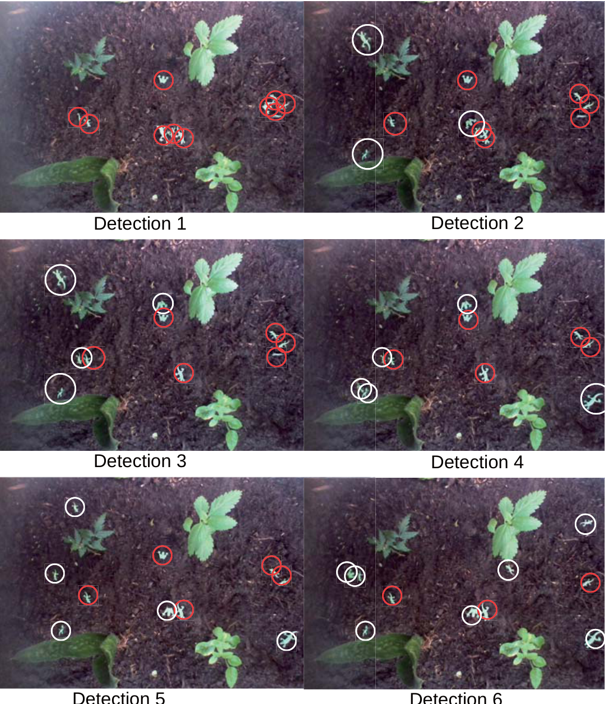

No laboratório GPAR da Universidade Federal do Ceará, uma equipe montou um robô de agricultura de precisão baseado no projeto aberto FarmBot. Instalado sobre um canteiro de horta, ele se move em três eixos e troca de ferramenta sozinho para semear, regar, medir a umidade do solo e eliminar ervas daninhas, comandado por um gêmeo digital na nuvem.

Eu não participei da construção do robô. Trabalhei na parte experimental, sobretudo no teste de corpos estranhos: imprimi em 3D os objetos usados no teste, trabalhei na visão computacional em Python, fotografei o canteiro ao longo dos testes e mantive a eletrônica funcionando.

## O sistema

Um Arduino Mega com shield RAMPS e drivers A4988 comanda os quatro motores de passo e lê os sensores de fim de curso. Um Raspberry Pi 4 conversa com a nuvem e processa as imagens de uma câmera boroscópica presa na ponta do braço. Uma fonte de 12 V alimenta tudo, com conversores CC-CC para os 5 V do Raspberry Pi e os 24 V da bomba de vácuo e da válvula solenoide.

## O que eu fiz

- **Experimento de luminosidade**: 15 plantas no canteiro, 4 cadastradas no sistema e 11 folhas fazendo o papel de ervas daninhas, com detecções registradas às 10 h, ao meio-dia e às 14 h durante 8 dias seguidos.
- **Teste de corpos estranhos**, a parte em que mais trabalhei: imprimi em 3D lagartos e sapos, pintados de verde e espalhados pelo canteiro, para ver se o algoritmo os confundia com ervas daninhas. Foram 40 rodadas de detecção.
- **Visão computacional em Python**: trabalhei no processamento das imagens da câmera para esse teste e participei da implementação da lógica nova de detecção (veja os resultados abaixo).
- **Coleta de imagens**: fotografei o canteiro e as detecções ao longo dos testes, para a análise dos resultados.
- **Manutenção da eletrônica**: mantive funcionando a caixa de controle, os motores, os sensores e os periféricos durante as semanas de testes.

## Resultados

Os experimentos mostraram os limites do algoritmo original de detecção:

- **Luz do dia**: a eficácia ficou entre 62,5 % e 68,2 % conforme o horário. O algoritmo detectava ervas daninhas demais, por causa de sombras, do reflexo do sol e da imagem achatada da câmera.
- **Corpos estranhos**: a eficácia caiu para 40 %. O algoritmo não sabia distinguir uma erva daninha de um objeto verde qualquer.

A partir desses resultados, propusemos uma lógica nova, que compara a posição dos objetos entre duas passagens da câmera: uma erva daninha cresce no mesmo lugar, um inseto se move. Participei da implementação dessa lógica em Python. Com ela, a eficácia no teste de corpos estranhos subiu de 40 % para **72,5 %**.

O trabalho foi publicado no *Journal of Artificial Intelligence and Systems* (vol. 7, p. 35–60, 2025), e eu sou um dos coautores. [Ler o artigo](https://doi.org/10.33969/AIS.2025070103).

## O que eu aprendi

- Planejar um experimento para que os números sejam comparáveis: mesmos horários, vários dias, média das medidas.
- Que um algoritmo de visão computacional depende tanto do ambiente (luz, sombra, câmera) quanto do código.
- Usar a impressão 3D como ferramenta de teste: objetos falsos e controlados para provocar os erros do algoritmo.
- Manter um sistema eletromecânico funcionando no dia a dia, fora da bancada.

*Figuras: Silva et al. (2025), sob licença [CC BY 4.0](https://creativecommons.org/licenses/by/4.0/).*
