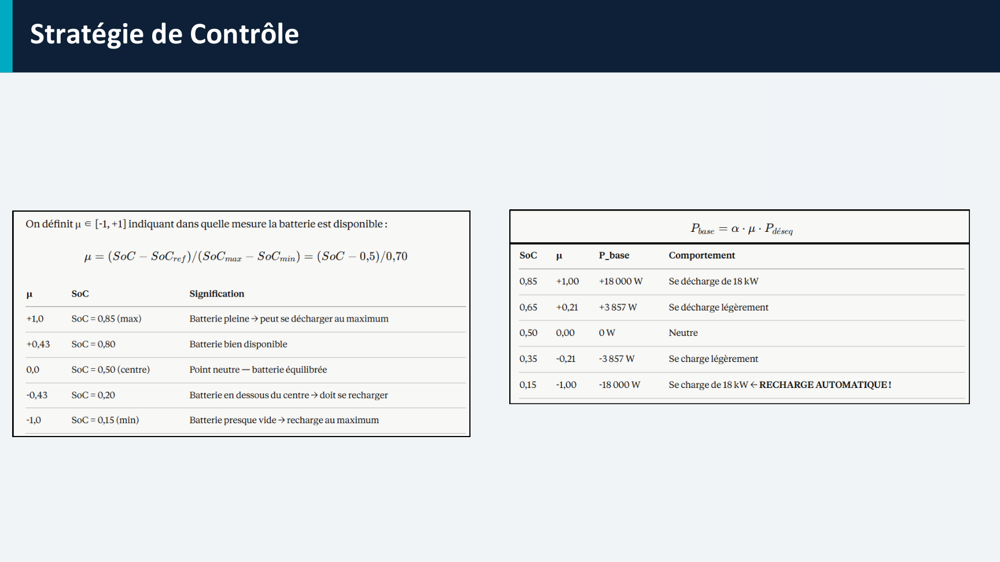
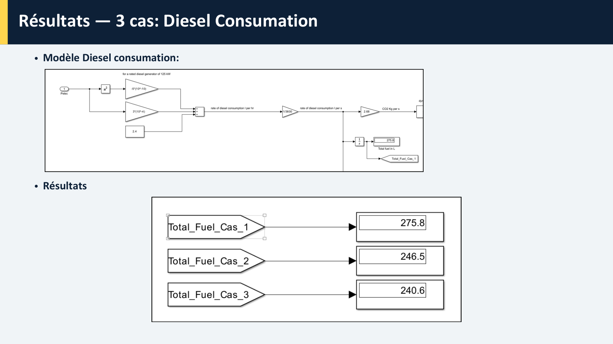
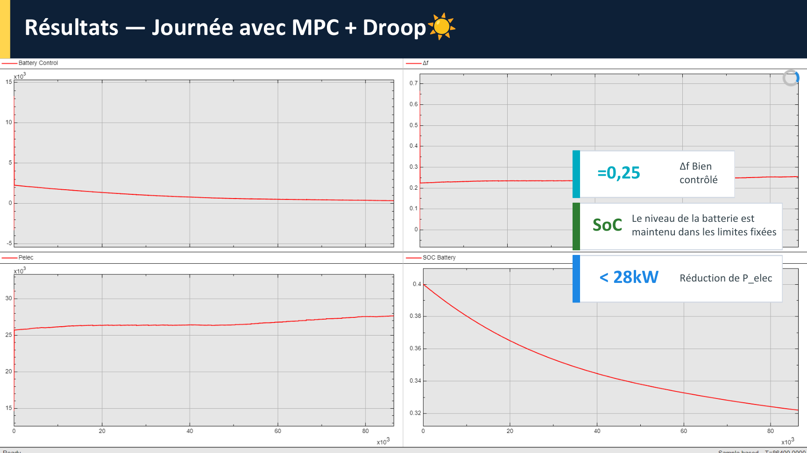

Projeto final da eletiva Smart Grid da École Centrale de Lille, feito em dupla com Ana Letícia Alves e orientado pelo professor Bruno François.

Numa microrrede isolada, um gerador diesel define a frequência de 50 Hz, mas responde devagar às variações de carga. O painel solar ajuda na energia, mas produz de forma intermitente e não ajuda a segurar a frequência. A bateria responde em milissegundos e pode compensar esses desequilíbrios, desde que seu estado de carga (SoC) seja bem gerido. O objetivo era projetar um controlador preditivo (MPC) para a bateria que mantivesse a frequência perto de 50 Hz, respeitasse os limites do SoC e reduzisse o consumo de diesel.

## A estratégia

Um primeiro MPC que só minimizava o desvio de frequência quase não agia: como o controle droop do gerador já corrigia boa parte do desvio, a bateria ficava subutilizada e o SoC sem controle. Por isso, dividimos o comando da bateria em dois níveis:

- **P_base**, lento: gestão de energia. Conforme o SoC, a bateria ajuda o gerador quando está carregada e se recarrega quando está baixa, sempre entre 15 % e 85 %.
- **P_mpc**, rápido: o MPC prevê a evolução da frequência num horizonte de 20 passos e calcula a cada instante a potência que corrige o desvio restante, dentro dos limites da bateria.

## O que eu fiz

Os modelos do gerador diesel e do controle droop vieram prontos da disciplina. A minha parte foi o controlador:

- **Formulação do MPC**: modelo da dinâmica da frequência a partir da equação de oscilação (swing equation), predição ao longo do horizonte e função de custo com pesos para o desvio de frequência e para o esforço da bateria.
- **Solução numérica**: como o `quadprog` é difícil de usar dentro de um bloco MATLAB Function, o problema de otimização é resolvido a cada passo por gradiente projetado, com as restrições de potência aplicadas por saturação.
- **Implementação no Simulink**: o bloco da bateria com o modelo do SoC, o MPC e o droop, integrado à simulação completa dos três cenários comparados.

## Resultados

Simulamos um dia inteiro, com perfis de consumo residencial e de produção solar, em três cenários:

| Cenário | Diesel consumido no dia |
|---|---|
| 1. Só o gerador diesel | 275,8 L |
| 2. Gerador + painel solar | 246,5 L (−10,6 %) |
| 3. Gerador + painel solar + bateria com MPC | **240,6 L (−12,8 %)** |

- **Frequência**: só com o droop, sobrava um erro permanente de cerca de 0,32 Hz. Com o MPC, o desvio caiu para cerca de 0,25 Hz: uma melhora real, mas parcial.
- **Bateria**: o SoC ficou dentro dos limites ao longo de todo o dia.

O professor gostou muito do trabalho, e o projeto foi aprovado com nota A+.

## O que eu aprendi

- Que um controlador "ótimo" no papel pode não fazer nada na prática: foi preciso entender por que o primeiro MPC ficava parado para chegar à estrutura em dois níveis.
- Levar uma formulação matemática de otimização para um bloco que roda a cada passo de simulação, com um método de solução simples e confiável.
- Os limites do resultado: ainda sobra um erro de frequência, que um ajuste dos pesos do MPC poderia reduzir. E a gestão do SoC só impede que a bateria se descarregue demais. Na simulação, ele caiu de 0,40 para cerca de 0,32 ao longo do dia. Os próximos passos seriam dar mais peso ao SoC para forçar a recarga, limitar a velocidade de carga e descarga e estender o controle a várias baterias (MPC distribuído).
