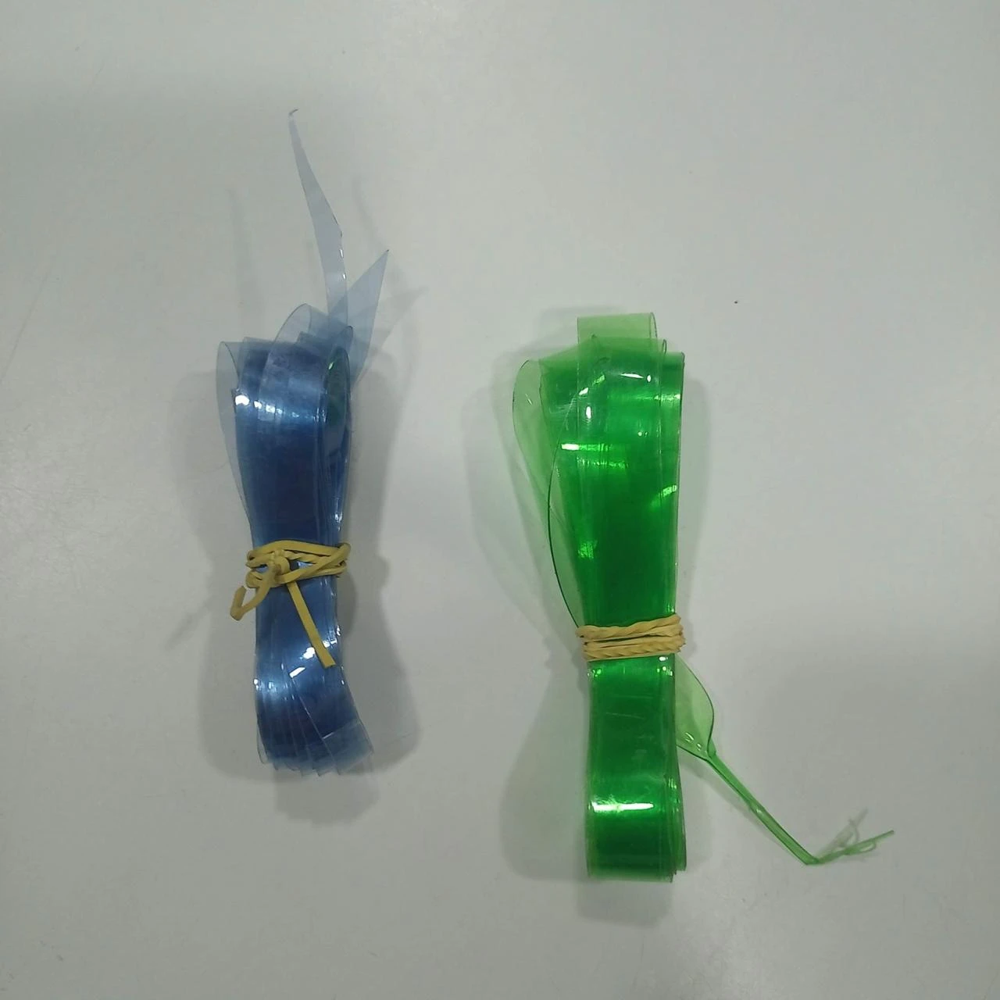
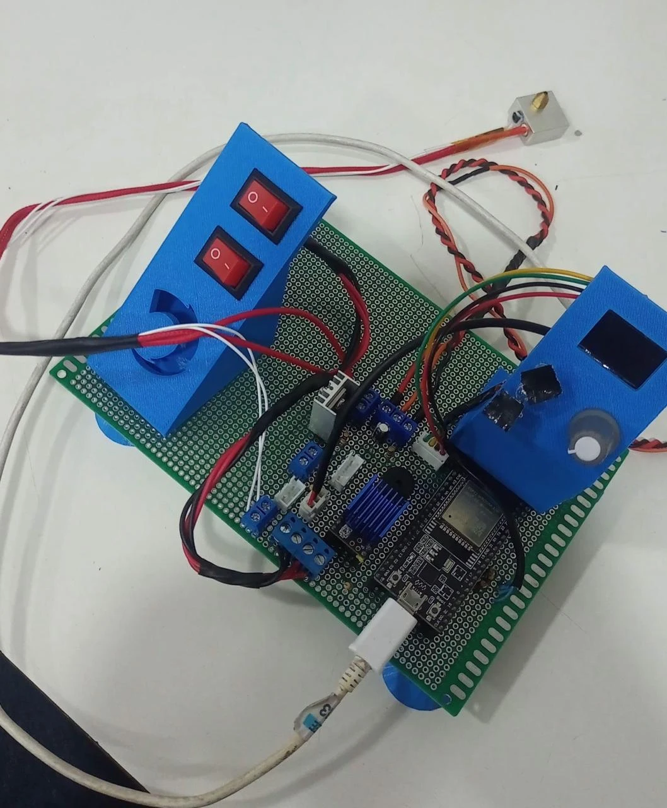
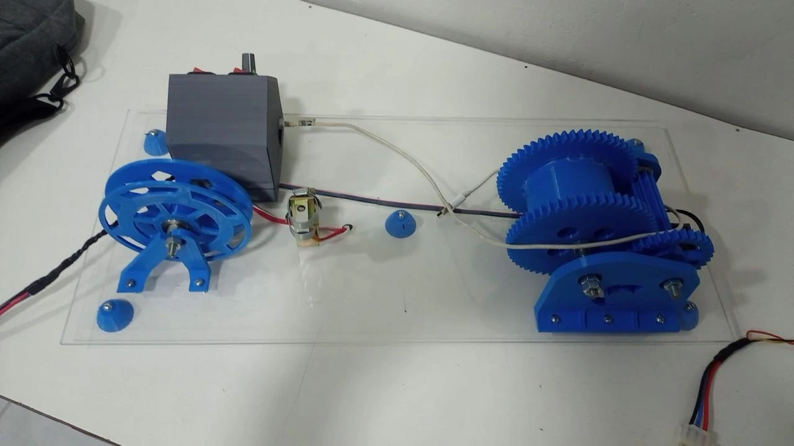
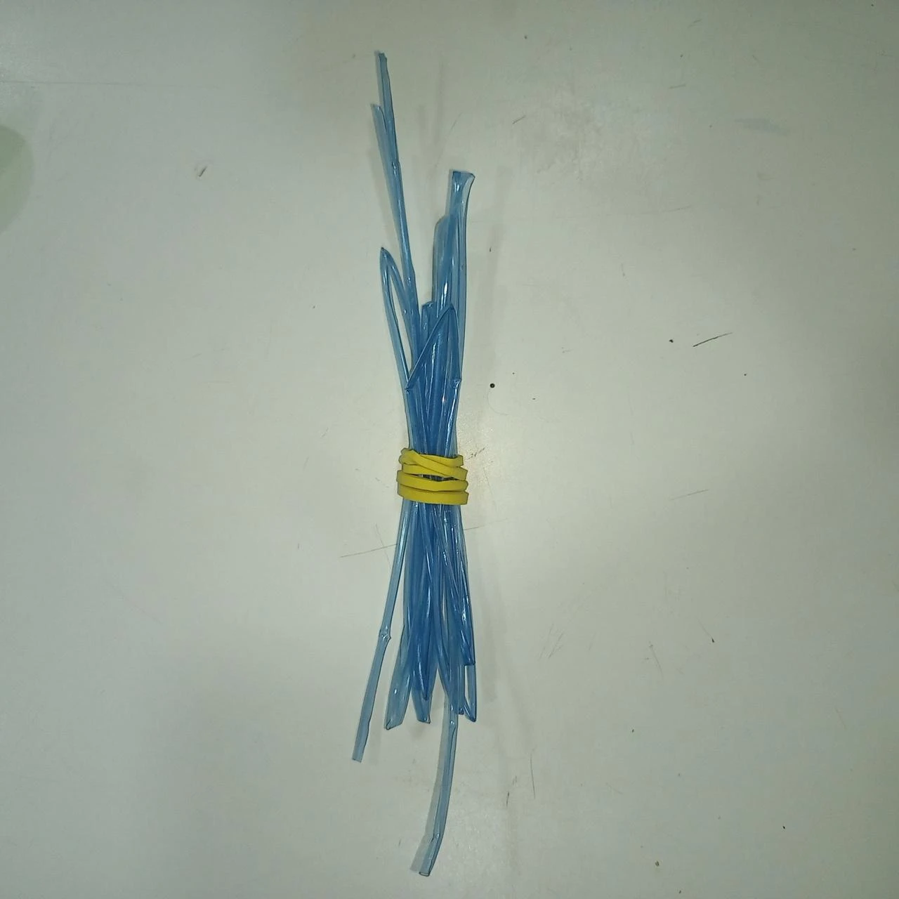

Nas férias de junho de 2024, como membro do PET Elétrica da Universidade Federal do Ceará, construí sozinho uma máquina que recicla garrafas PET e as transforma em filamento para impressora 3D.

O processo tem três etapas. A garrafa é cortada em uma tira contínua, enrolada em um carretel. Essa tira passa por um bico extrusor de impressora 3D aquecido, que a funde e a molda no diâmetro padrão de 1,75 mm. Na saída, o filamento é puxado por um motor de passo e enrolado em outro carretel, pronto para usar.

Eu estava no 3º semestre de engenharia: quase tudo o que o projeto exigia, aprendi do zero antes de aplicar.

## O que eu fiz

- **Controle de temperatura do bico**, a parte central do projeto: leitura por termistor, aquecimento chaveado por um MOSFET com PWM e um controlador PID rodando no ESP32. Ajustei os ganhos de forma empírica, com potenciômetros na própria máquina.
- **Tração do filamento** com um motor de passo e seu driver, com velocidade ajustável por potenciômetro.
- **Interface** em um display OLED 128×64: animação de inicialização, menu, temperatura, velocidade e mensagens de erro.
- **Segurança**: um sensor detecta quando a tira se rompe; a máquina então dispara um aviso sonoro e luminoso e inicia o desligamento. Há também proteção contra superaquecimento do bico.
- **Firmware** em C/C++, testado antes no simulador Wokwi e compilado no VS Code.
- **Montagem da eletrônica**: circuito planejado no KiCad e montado em placa perfurada, com os componentes e conectores soldados à mão.
- **Mecânica**: modelei no Fusion 360 e imprimi (PrusaSlicer) todas as peças da máquina, além de um case para a eletrônica.

## Resultados

A máquina funcionou de ponta a ponta e produziu filamento de 1,75 mm a partir de garrafas PET.

- **Temperatura estável**: no início, a temperatura do bico oscilava demais. Uma camisa de silicone em volta do bico reduziu a variação para cerca de 3 °C.
- **Rompimento da tira**: virou um caso tratado, com detecção e desligamento automático, em vez de uma falha silenciosa.
- **Limite encontrado**: as peças mecânicas foram impressas em PLA, o único material disponível. Com o uso, uma engrenagem quebrou, e não houve tempo de refazê-la antes do fim do período.

Apresentei o projeto a um grupo de professores franceses em visita à UFC e nos Encontros Universitários da UFC de 2024.

## O que eu aprendi

- Fechar uma malha de controle de verdade: o PID só ficou estável depois de cuidar também do lado térmico (a camisa de silicone), não apenas dos ganhos.
- Levar um circuito do esquemático à placa soldada, passando pela simulação.
- Pensar em falhas desde o começo: sensores e avisos tornam uma máquina usável por outra pessoa.
- Escolher o material das peças de acordo com o esforço que elas sofrem. Numa próxima versão, eu faria as engrenagens em PETG ou nylon, ou compraria peças metálicas.
